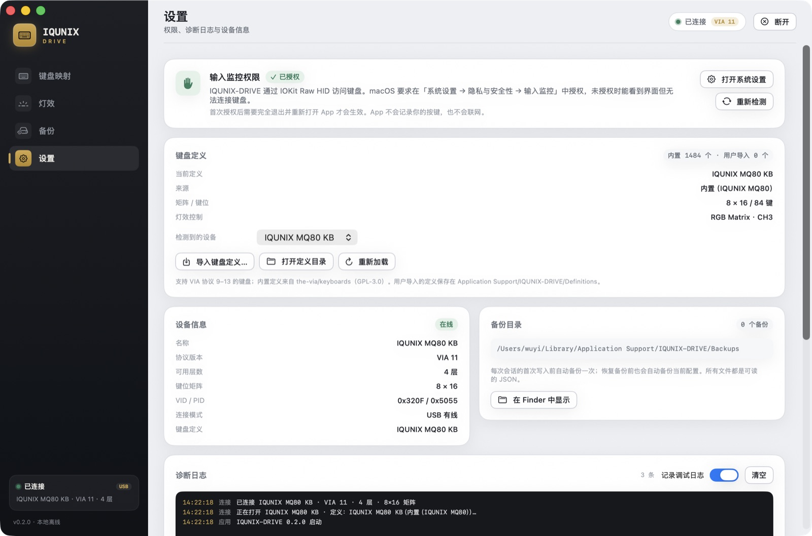
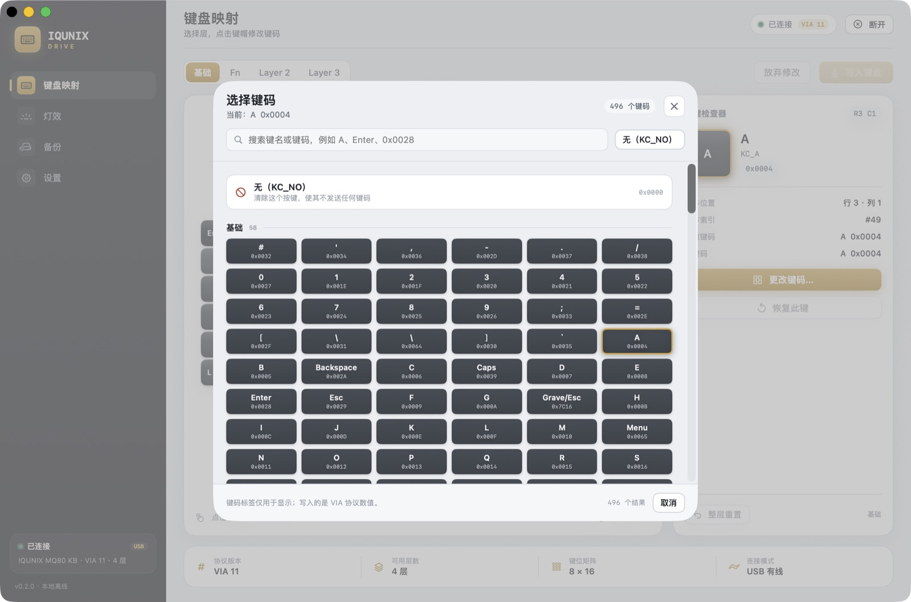
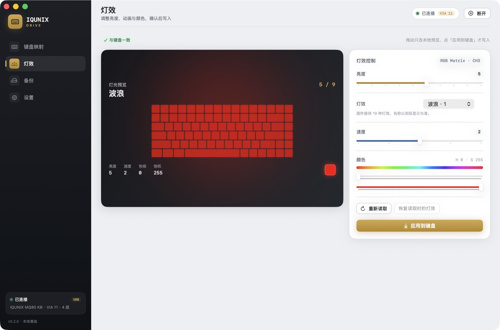
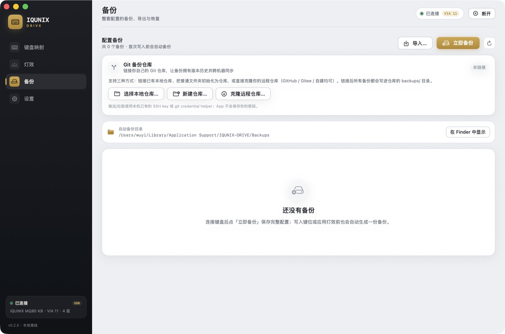

# IQUNIX-DRIVE

一个**通用**的 macOS 原生 VIA 键盘配置工具 —— 自动识别可配置键盘、匹配键盘定义，离线运行、无需浏览器、无需厂商 Windows 软件。IQUNIX MQ80 有内置的官方定义与专用写入兼容路径。

- SwiftUI + IOKit Raw HID，直接通过键盘自带的 VIA 协议读写。
- **自动识别**：扫描所有暴露 VIA Raw HID（`0xFF60 / 0x61`）的键盘，按 VID/PID 匹配定义。
- **内置 1,484 个 VIA 键盘定义**（来自 the-via/keyboards，GPL-3.0），覆盖绝大多数 VIA 键盘；不认识的键盘可以导入 VIA JSON 定义。
- 功能：键位映射（多层）、RGB/背光灯效、备份/恢复、**Git 仓库备份**、诊断日志。
- 安全策略：写前自动备份、写后回读校验；不写固件、不跳 Bootloader。



## 支持的键盘

| 情况 | 支持方式 |
| --- | --- |
| IQUNIX MQ80（`0x320F/0x5055`、2.4G 接收器 `0x5088`） | 内置官方定义 + 专用写入兼容路径（规避固件 `0x13` 层边界 bug） |
| VIA 协议 9–13、暴露 `0xFF60/0x61` 的键盘 | 自动匹配内置 1,484 个定义，直接编辑 |
| 内置库没有的 VIA 键盘 | App 会识别到设备并提示导入该键盘的 VIA JSON 定义（`设置 → 键盘定义 → 导入`） |

**暂不支持**：定义里的布局变体（split space / ISO 等按默认布局显示；写入不影响布局选项）、编码器（旋钮）映射、宏写入、固件升级；蓝牙/2.4G 下的配置（MQ80 也只保证 USB 有线）。

## 功能

| 页面 | 能力 |
| --- | --- |
| 键盘映射 | 按定义渲染任意布局、Layer 切换、键码选择器（按 VIA 协议版本自动选 v11/v12/v13 键码表）、自定义键、单键/整层恢复、暂存修改后统一写入并回读校验 |
| 灯效 | 按定义解析灯效通道（backlight / rgblight / rgb_matrix 或自定义菜单），亮度/灯效/速度/颜色；无灯效定义的键盘会显示说明 |
| 备份 | 写入前自动备份、立即备份、导入/导出 JSON、恢复、删除 |
| Git 备份仓库 | 链接你自己的 Git 仓库（本地/新建/克隆远程），备份自动 commit，可 push/pull，详见 [docs/git-backup.md](docs/git-backup.md) |
| 设置 | 输入监控权限、键盘定义库（1,484 个内置 + 用户导入）、设备选择、备份目录、诊断日志 |






## 安装（Homebrew）

> 仓库不提交构建产物（`dist/` 已忽略）。首次安装前请先构建一次：
> `./scripts/build.sh release && ./scripts/make-app.sh`（只需 Command Line Tools）。

```bash
cd /Volumes/MyFiles/Projects/IQUNIX-DRIVE
# Homebrew 7 对“从路径加载的 cask”要求开发者模式
HOMEBREW_DEVELOPER=1 brew install --cask ./Casks/iqunix-drive.rb
open "/Applications/IQUNIX-DRIVE.app"
```

> 已在 Homebrew 7.0.9 实测安装成功（安装到自定义 `--appdir` 验证）。如果 `/Applications` 不可写，加 `--appdir="$HOME/Applications"`。
> 本地 tap 方式见 [docs/build-and-install.md](docs/build-and-install.md) §4.2。

**首次启动**：macOS 会要求「输入监控（Input Monitoring）」权限 → 系统设置 → 隐私与安全性 → 输入监控 → 勾选 **IQUNIX-DRIVE** → 退出并重新打开 App。App 不记录键盘输入，也不联网。

**手动安装**：

```bash
ditto -x -k dist/IQUNIX-DRIVE-0.2.0.zip /tmp/iqunix-install
cp -R /tmp/iqunix-install/IQUNIX-DRIVE.app "/Applications/"
open "/Applications/IQUNIX-DRIVE.app"
```

## 使用

1. 用 USB 数据线连接键盘，切到有线模式（IQUNIX MQ80：**Fn + 5**；其他键盘按厂商说明）。
2. 打开 App，顶部出现「已连接 VIA xx」即成功；设置页可以看到自动匹配的键盘定义。
3. **改键**：选层 → 点击键帽 → 「更改键码…」→ 选择键码 → 顶部「写入键盘」。
4. **灯效**：调整参数 → 「应用到键盘」（定义没有灯效菜单时会显示说明）。
5. **备份**：写入前会自动备份；可在「备份」页手动备份/导出，或链接 Git 仓库自动提交版本。

### 遇到内置库没有的键盘

连接后 App 会显示「需要这个键盘的定义」：

- 点「导入键盘定义…」，选择该键盘的 VIA JSON 定义（厂商提供，或来自 [VIA keyboards](https://github.com/the-via/keyboards)）
- 定义会保存到 `~/Library/Application Support/IQUNIX-DRIVE/Definitions/`，之后自动匹配
- 也可以把定义文件放进该目录后点「重新加载」

## 已知限制

- 布局变体（如 ISO Enter / split space）只按默认布局显示，键位写入不受影响。
- 编码器（旋钮）映射、宏写入暂不支持。
- 固件升级 / bootloader 不在这版范围内（MQ80 官方只有 Windows 升级工具）。
- 仅建议在有线模式下配置；2.4G 接收器虽有 VIA 接口，但写入行为未验证。
- 灯效能力取决于键盘定义；内置定义库中部分键盘没有灯效菜单。
- ad-hoc 签名、未公证，仅适合本机自用；移动/重签 App 后可能重新请求输入监控权限。

## 从源码构建

只需 Command Line Tools（不需要完整 Xcode）：

```bash
./scripts/build.sh release          # → .build-manual/iqunixctl, .build-manual/IQUNIX-DRIVE
./scripts/make-app.sh               # → dist/IQUNIX-DRIVE.app + zip + 同步 cask sha256
./scripts/verify.sh                 # 真机只读自检 + 安全写回校验
```

- 键盘定义库生成：`python3 scripts/gen_via_definitions.py`（扫描 `third_party/via-keyboards`，输出 `Resources/VIAKeyboardDefinitions`）
- 键码表生成：`python3 scripts/gen_keycodes.py`（v11/v12/v13）
- `make-app.sh` 会把定义库复制进 `IQUNIX-DRIVE.app/Contents/Resources/VIAKeyboardDefinitions`
- UI 截图辅助：`MQ80STUDIO_SECTION=lighting ...`、`MQ80STUDIO_SELECT_KEY=49 ...`、`MQ80STUDIO_OPEN_PICKER=1 ...`

## CLI

```bash
./.build-manual/iqunixctl devices                 # 列出所有可配置 VIA 键盘 + 定义匹配状态
./.build-manual/iqunixctl info                    # 设备/协议/定义信息
./.build-manual/iqunixctl selftest                # 只读自检
./.build-manual/iqunixctl dump                    # 打印所有层键位
./.build-manual/iqunixctl backup ~/keyboard.json  # 完整备份（键位+灯效+宏原始数据）
./.build-manual/iqunixctl restore ~/keyboard.json --yes
./.build-manual/iqunixctl lighting                # 查看灯效
./.build-manual/iqunixctl lighting --brightness 6 # 设置灯效（写入并回读校验）
./.build-manual/iqunixctl writeback-test          # 原样写回+校验（安全写测试）
./.build-manual/iqunixctl definitions             # 定义库统计
./.build-manual/iqunixctl import-definition def.json
./.build-manual/iqunixctl lookup-definition 320F 5055
./.build-manual/iqunixctl check-definitions       # 全量校验内置定义解析

# Git 备份仓库（与 App 共用配置）
./.build-manual/iqunixctl git-clone git@github.com:you/keyboard-backups.git ~/Keyboard-Backups
./.build-manual/iqunixctl git-backup --push
./.build-manual/iqunixctl git-status
./.build-manual/iqunixctl git-pull
./.build-manual/iqunixctl git-unlink
```

## 自动识别原理

1. `VIADiscovery` 枚举所有 HID 设备，筛选 `UsagePage 0xFF60 / Usage 0x61`（VIA Raw HID）。
2. 按 VID/PID 查定义：**用户导入 → IQUNIX MQ80 内置 → 内置 1,484 个 VIA 定义库**。
3. 从设备读取 VIA 协议版本、层数；矩阵行列来自定义。
4. 键码表按协议版本选择（11→v11、12→v12、13+→v13）；自定义键码 base 也随版本变化。
5. 写入策略：MQ80 固件用逐键 `0x05`（规避 `0x13` 层边界 bug）；其他键盘用标准 `0x13` 连续分块写入。
6. 找不到定义时：识别设备但进入「需要定义」状态，提供导入入口；不猜测布局、不冒险写错键位。

## 项目结构

```
Sources/MQ80Core/       HID 传输、VIA 协议、键盘定义解析、定义库、键码表、备份、Git 备份
Sources/MQ80Studio/     SwiftUI App（AppModel / HIDWorker / 各页面）
Sources/mq80ctl/        CLI 源码（产物名 iqunixctl）
Resources/VIAKeyboardDefinitions/   内置 1,484 个 VIA 定义 + index.json
third_party/via-keyboards/          定义库源数据（GPL-3.0）
scripts/                build / make-app / 定义库与键码生成 / verify / 截图辅助
Casks/                  Homebrew cask（iqunix-drive）
docs/                   可行性、协议笔记、构建安装、Git 备份、定义报告、调研报告、截图
tools/probe/            MQ80 真机协议探针（C / IOKit）
definition/             IQUNIX MQ80 官方 VIA 定义
```

## 文档

- [docs/feasibility.md](docs/feasibility.md) —— IQUNIX MQ80 可行性报告（协议验证、方案演进）
- [docs/protocol-notes.md](docs/protocol-notes.md) —— VIA Raw HID 协议实测笔记（MQ80）
- [docs/git-backup.md](docs/git-backup.md) —— Git 备份仓库使用说明
- [docs/build-and-install.md](docs/build-and-install.md) —— 构建、打包、签名、Homebrew 安装
- [docs/definitions-report.md](docs/definitions-report.md) —— 内置 VIA 定义库生成报告
- [docs/research-official.md](docs/research-official.md)、[docs/research-macos.md](docs/research-macos.md) —— 调研资料

## 免责声明

个人自用工具，与 IQUNIX 官方无关。只通过 VIA 协议读写键盘自身的键位/灯效 EEPROM，**不修改固件**。内置的 VIA 键盘定义来自 the-via/keyboards（GPL-3.0），原始版权归各键盘作者；IQUNIX MQ80 官方定义版权归 IQUNIX。
