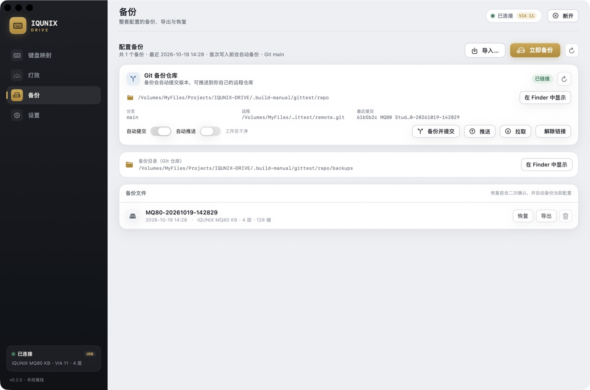

# Git 备份仓库

IQUNIX-DRIVE 的备份可以直接写进**你自己的 Git 仓库**：每次备份生成一个 JSON 文件并自动提交（commit），需要时推送到远程（GitHub / Gitee / 自建 Git 均可）。这样备份具备：

- 完整版本历史，可回滚到任意一次备份；
- 跨机器同步（在公司/家里各装一份 App，拉取同一仓库即可恢复）；
- 不依赖任何云服务，仓库归你所有；
- 备份文件和普通文件一样可读、可 diff、可审计。



## 三种链接方式

进入 **备份 → Git 备份仓库**（未链接状态）：


支持三种方式：

| 方式 | 适合场景 |
| --- | --- |
| **选择本地仓库…** | 已经有本地 Git 仓库（或一个普通文件夹，App 会自动 `git init`） |
| **新建仓库…** | 选一个空文件夹，App 初始化仓库并做首次提交 |
| **克隆远程仓库…** | 你已经在 GitHub/Gitee 建好空仓库或备份仓库，填入地址后 App 克隆到本地并链接 |

克隆支持 HTTPS / SSH 地址，例如：

```
https://github.com/<you>/iqunix-drive-backups.git
git@github.com:<you>/iqunix-drive-backups.git
```

> 私有仓库需要本机已经配置好 SSH key 或 git credential helper。App 不会保存任何密码/token。

链接后，所有备份都会写到：

```
<你的仓库>/backups/MQ80-YYYYMMDD-HHmmss.json
```

## 自动行为

| 操作 | 行为 |
| --- | --- |
| 手动「立即备份 / 备份并提交」 | 保存备份 → `git add backups/` → `git commit`；若开了「自动推送」则继续 `git push` |
| 写入键位 / 应用灯效前的自动备份 | 保存备份并按设置自动 commit / push（「自动提交」默认开启，「自动推送」默认关闭） |
| 「推送」 | `git push`（没有 upstream 时自动 `git push -u origin <branch>`） |
| 「拉取」 | `git pull --ff-only`，拉取后备份列表自动刷新 |
| 「解除链接」 | 只解除 App 的链接，仓库和备份文件**不会删除**；备份切回本地目录 |

App 只 `git add backups/` 并只提交这个目录，**不会提交仓库里的其他文件**。

## 凭证与安全

- 推送/拉取复用本机 git 的凭证机制（SSH key、`credential.helper`、`gh auth` 等）。
- App 以非交互方式运行 git（`GIT_TERMINAL_PROMPT=0`），需要输入密码时会直接报错，不会卡住。
- 链接配置只保存仓库路径和两个开关，存于：
  `~/Library/Application Support/IQUNIX-DRIVE/git-backup.json`
- 备份 JSON 包含键位、灯效和宏原始数据（宏内容可能包含你输入过的文本），**建议使用私有仓库**。

## 从 Git 历史恢复

App 的备份列表显示的是工作区中当前的备份文件，直接点「恢复」即可。若想恢复更早的提交：

```bash
cd <你的备份仓库>
git log --oneline -- backups/
git show <commit>:backups/Keyboard-20261019-140054.json > /tmp/old-backup.json
```

然后在 App 里 **备份 → 导入…** 选择 `/tmp/old-backup.json`，确认后恢复。

或者直接 checkout 某个历史文件到工作区，再在 App 列表里恢复。

## CLI 等价操作

App 的 Git 备份和 CLI 共用同一份配置与实现：

```bash
./.build-manual/iqunixctl git-link ~/IQUNIX-Backups            # 链接/初始化本地仓库
./.build-manual/iqunixctl git-clone git@github.com:you/iqunix-drive-backups.git ~/IQUNIX-Backups
./.build-manual/iqunixctl git-status
./.build-manual/iqunixctl git-backup --push                  # 备份 + 提交 + 推送
./.build-manual/iqunixctl git-push
./.build-manual/iqunixctl git-pull
./.build-manual/iqunixctl git-unlink
```

## 常见问题

| 问题 | 处理 |
| --- | --- |
| `git 命令失败` / 找不到 git | `xcode-select --install` 安装 Command Line Tools |
| 推送失败（403/认证） | 配置 SSH key 或 `git config --global credential.helper osxkeychain`，先在终端里成功 `git push` 一次 |
| 提示 no upstream | App 会自动执行 `git push -u origin <branch>`；也可以手动设置 upstream |
| 拉取失败 non-fast-forward | 先处理仓库冲突（App 使用 `--ff-only`，不会自动 merge/覆盖） |
| 没有提交身份 | 优先使用你的全局 `user.name/user.email`；若没有，App 会为该仓库设置本地身份 `IQUNIX-DRIVE <iqunix-drive@localhost>` |
| 工作区有别的文件 | 正常，App 只提交 `backups/` 目录，不影响你的其他文件 |

## 实现说明

- 代码：`Sources/MQ80Core/GitBackup.swift`（Git 调用与状态解析）、`Sources/MQ80Studio/AppModel.swift`（自动备份/提交联动）、`Sources/MQ80Studio/BackupView.swift`（链接/推送/拉取 UI）。
- 所有写操作通过 `Process` 直接执行 `/usr/bin/git`，参数数组传递，不经过 shell，避免命令注入。
